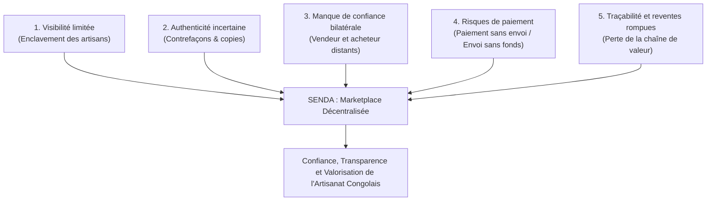
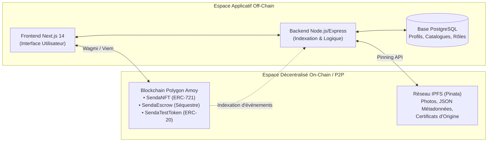

# SENDA — PRÉSENTATION GÉNÉRALE DU PROJET
**Document de Référence & Cadrage Stratégique**  
**Projet :** SENDA — Marketplace décentralisée de l'artisanat congolais  
**Slogan :** *L'artisanat congolais, authentifié et valorisé.*  
**Niveau académique :** Master 1 Informatique — Année 2026–2027 (Groupe 02)  
**Auteurs :** Kabongo Mukola Nathan | Losongo Kingombe Victor | Tuasansilu Lufuma Benie  

---

## 1. Résumé exécutif

Le projet **SENDA** est une plateforme de commerce électronique décentralisée conçue pour transformer la valorisation, la commercialisation et la traçabilité de l'artisanat traditionnel et contemporain de la République démocratique du Congo (RDC).

Face aux limitations structurelles des marchés traditionnels et des plateformes de vente en ligne centralisées (manque de visibilité internationale des créateurs locaux, risques d'impayés, contrefaçons, absence de traçabilité des pièces d'art et opacité lors des reventes secondaires), SENDA propose un modèle hybride innovant :
* **Une expérience e-commerce fluide et accessible**, permettant aux acheteurs du monde entier de découvrir le patrimoine matériel congolais (sculptures sur bois précieux, vannerie d'art, toiles du Kongo central, bijoux en malachite, textiles raphia Shoowa et créations contemporaines).
* **Une certification numérique décentralisée via NFT (ERC-721)** couplée à un stockage pérenne des images et métadonnées sur **IPFS**, créant un certificat d'authenticité et d'enregistrement numérique inaltérable.
* **Un protocole de paiement sécurisé sous séquestre (*escrow*)**, bloquant les jetons de paiement jusqu'à ce que l'acheteur confirme la réception physique et la conformité de l'œuvre livrée.
* **Un mécanisme de reconnaissance des créateurs via les redevances on-chain (ERC-2981)**, garantissant aux artisans congolais une rétribution équitable sur les éventuelles transactions secondaires futures.

SENDA ne se positionne pas comme une spéculation numérique autour d'œuvres virtuelles dématérialisées, mais comme **une passerelle technologique d'impact réel reliant l'objet physique artisanal à son double numérique sécurisé sur la blockchain Polygon Amoy**.

---

## 2. Contexte et justification

La République démocratique du Congo possède l'un des patrimoines artisanaux les plus riches et diversifiés du continent africain. De l'art statuaire Tshokwe et Luba aux masques Pende, en passant par les textiles Shoowa du Kasaï et les pièces modernes de Kinshasa et Lubumbashi, l'artisanat congolais incarne une valeur culturelle, historique et économique majeure.

Cependant, ce secteur vital souffre d'un sous-développement numérique et d'un enclavement géographique préjudiciable :
1. **Isolement des artisans locaux :** La majorité des maîtres artisans et coopératives dépendent du passage aléatoire de touristes ou d'intermédiaires informels imposant des marges abusives.
2. **Vulnérabilité des échanges à distance :** Vendre une pièce d'art congolaise à un acheteur situé en Europe, en Amérique ou ailleurs en Afrique expose les deux parties à un risque asymétrique élevé : l'artisan redoute d'expédier un objet précieux sans certitude d'être payé, tandis que l'acheteur hésite à payer un vendeur anonyme sans garantie de livraison.
3. **Plagiat et dévaluation culturelle :** De nombreuses copies industrielles sont commercialisées sur les marchés mondiaux sous l'étiquette trompeuse d'« art africain authentique », privant les artisans congolais de leur identité et de leurs revenus légitimes.
4. **Absence d'historique de propriété :** Lorsqu'une œuvre artisanale d'exception change de propriétaire, la chaîne de transmission se perd, et l'artisan originel ne bénéficie jamais de la plus-value générée au fil du temps.

L'avènement des technologies Web3 (contrats intelligents, registres distribués, jetons non fongibles et systèmes de séquestre décentralisés) fournit l'infrastructure idoine pour résoudre ces défaillances de marché sans recourir à un tiers de confiance bancaire centralisé onéreux et souvent inaccessible aux artisans locaux.

---

## 3. Problématique détaillée

Le projet SENDA répond formellement à cinq problématiques interconnectées :

1. **Visibilité limitée :** Les artisans ne disposent pas d'une vitrine numérique globale capable de mettre en scène leurs créations avec une traçabilité d'origine rigoureuse.
2. **Authenticité difficile à vérifier :** L'acheteur à distance manque de preuves tangibles quant à l'origine déclarée, aux matériaux employés et à l'identité de l'artisan producteur.
3. **Défiance bilatérale :** L'absence d'antériorité ou de réputation vérifiable paralyse les transactions entre particuliers et artisans indépendants.
4. **Risque de contrepartie financière :** Le paiement direct est binaire et risqué. L'artisan craint la répudiation bancaire, l'acheteur craint la disparition du colis.
5. **Traçabilité insuffisante des transmissions :** Les cessions ultérieures de l'œuvre s'opèrent de gré à gré sans aucun lien avec le créateur, privant le patrimoine congolais d'une mémoire historique vérifiable.

---

## 4. Vision et mission

### 4.1. Vision
Faire de l'artisanat congolais une référence mondiale d'art authentifié, équitable et technologiquement valorisé, où chaque artisan devient propriétaire souverain de son identité numérique et de la traçabilité de ses créations.

### 4.2. Mission
Concevoir, déployer et exploiter une marketplace web décentralisée qui relie directement les créateurs congolais aux amateurs d'art du monde entier, en intégrant un système de certification NFT ERC-721, un stockage IPFS décentralisé et un protocole de séquestre garantissant la sécurité totale des fonds jusqu'à la livraison physique conforme.

---

## 5. Objectifs du projet

### 5.1. Objectif général
Concevoir et développer une marketplace décentralisée qui facilite la commercialisation de l'artisanat congolais tout en renforçant la traçabilité numérique, la confiance et la sécurité des paiements.

### 5.2. Objectifs spécifiques
* **OS-1 : Catalogue & Espaces dédiés :** Mettre en place une interface de commerce électronique claire permettant la consultation publique du catalogue et la gestion dédiée pour les acheteurs et les artisans.
* **OS-2 : Enregistrement décentralisé :** Associer chaque création physique authentifiée à un jeton non fongible (NFT) ERC-721 hébergé sur Polygon Amoy.
* **OS-3 : Pérennité des métadonnées :** Garantir la conservation immuable des descriptifs, photographies haute résolution et certificats d'origine sur le réseau IPFS via le service Pinata.
* **OS-4 : Séquestre contractuel (*Escrow*) :** Automatiser la rétention des paiements dans un contrat intelligent autonome (`SendaEscrow.sol`), empêchant tout détournement avant validation de la livraison.
* **OS-5 : Paiement en jeton de démonstration :** Émettre un jeton de test ERC-20 (`SendaTestToken.sol`) permettant d'exécuter l'intégralité du cycle d'achat sur le testnet sans engager de fonds monétaires réels.
* **OS-6 : Confirmation et libération conditionnelle :** Permettre à l'acheteur d'attester la réception physique pour déclencher la libération automatique des fonds vers le portefeuille de l'artisan.
* **OS-7 : Redevances pérennes (ERC-2981) :** Préparer le reversement automatique d'un pourcentage sur les ventes secondaires futures aux artisans.
* **OS-8 : Traçabilité publique :** Exposer l'historique complet et transparent des événements et transferts sur un explorateur de blocs public (Polygon Amoy Explorer).

---

## 6. Solution proposée : Architecture tripartite hybride

Pour concilier ergonomie grand public et garanties cryptographiques, SENDA adopte une architecture tripartite :

1. **La couche d'interface et d'expérience utilisateur (Next.js 14 / Tailwind CSS) :** Accessible sans barrière technique. Les visiteurs consultent le catalogue sans obligation de connecter un portefeuille, découvrent les artisans, leurs provinces d'origine et leurs histoires.
2. **La couche de données applicatives (Node.js, Express, PostgreSQL) :** Assure la performance de recherche, la gestion des catégories, l'historique utilisateur, l'indexation des transactions blockchain et le suivi du processus de vérification des artisans.
3. **La couche de confiance décentralisée (Solidity, Polygon Amoy, IPFS) :** Gère la frappe des certificats NFT, la conservation immuable des métadonnées multimédias et le séquestre inviolable des fonds financiers.

---

## 7. Valeur ajoutée de SENDA

| Dimension | Marketplace e-commerce classique (Web2) | Plateforme NFT généraliste (OpenSea, Rarible) | SENDA (Marketplace Artisanale Décentralisée) |
| :--- | :--- | :--- | :--- |
| **Objet commercialisé** | Biens matériels génériques. | Fichiers numériques purs (images, avatars, collectibles). | **Œuvres d'artisanat physiques authentifiées** liées à un double numérique. |
| **Règlement financier** | Carte bancaire, PayPal, intermédiaires à commissions élevées (10 à 30%). | Crypto-monnaies volatiles avec exécution atomique immédiate. | **Séquestre décentralisé conditionné à la livraison physique**. |
| **Protection de l'acheteur** | Procédures de réclamation centralisées, opaques et lentes. | Aucune : le swap est définitif, tout achat est irréversible. | **Les fonds restent bloqués jusqu'à confirmation explicite de conformité**. |
| **Garantie d'origine** | Simple déclaration non auditable sur une base privée. | Authenticité du smart contract uniquement, décorrélation physique. | **Audit d'origine artisanale préalable** + métadonnées certifiées sur IPFS. |
| **Valorisation post-vente**| L'artisan ne perçoit rien lors des reventes futures de son œuvre. | Redevances logicielles souvent contournées par les agrégateurs. | **Norme ERC-2981 inscrite on-chain** pour protéger les droits de l'artisan. |

---

## 8. Utilisateurs cibles et rôles

* **Visiteur (Grand Public / Diaspora / Collectionneurs) :**
  Découvre le patrimoine artisanal congolais, parcourt le catalogue d'œuvres, filtre par catégorie ou région, consulte l'origine déclarée et les détails techniques de l'œuvre sans barrière d'accès.
* **Artisan Vendeur :**
  Créateur congolais ou coopérative artisanale. Soumet sa candidature pour vérification, publie ses créations avec photographies et descriptions détaillées, suit l'état de ses commandes, prépare l'expédition et reçoit son paiement débloqué par le contrat de séquestre dès livraison.
* **Acheteur :**
  Connecte son portefeuille MetaMask, échange ou reçoit des jetons de test ERC-20, dépose les fonds sous séquestre pour réserver l'œuvre physique et confirme la bonne réception pour libérer le paiement à l'artisan.
* **Administrateur / Vérificateur SENDA :**
  Assure le contrôle qualité des dossiers d'artisans, vérifie la réalité des ateliers locaux, valide l'authenticité déclarée des œuvres avant autorisation de publication et surveille la bonne santé du système.

---

## 9. Périmètre du projet (MVP vs Post-MVP)

### 9.1. Périmètre strict du MVP (Minimum Viable Product)
Le MVP validé lors de cette première étape se concentre exclusivement sur le **parcours nominal d'une œuvre artisanale unique** :
1. Connexion fluide d'un portefeuille MetaMask sur le réseau de test Polygon Amoy.
2. Consultation fluide d'un catalogue d'œuvres artisanales congolaises.
3. Fiche détaillée d'une œuvre distinguant les informations déclarées, vérifiées et enregistrées on-chain.
4. Formulaire de publication pour un artisan habilité avec upload réel des photos et du JSON de métadonnées sur IPFS via Pinata.
5. Minting du NFT ERC-721 certifiant l'enregistrement numérique de la pièce.
6. Achat d'une œuvre via le contrat de séquestre `SendaEscrow.sol` utilisant le jeton de test ERC-20 `SendaTestToken.sol`.
7. Blocage effectif des fonds et passage de la commande au statut `Funded`.
8. Confirmation de réception physique par l'acheteur et libération des fonds au vendeur (`Released`).
9. Consultation de l'historique de la transaction sur Polygon Amoy.
10. Couverture complète par des tests automatisés (parcours nominaux et tentatives non autorisées).

### 9.2. Périmètre Post-MVP (Améliorations futures)
* Système automatisé de gestion des litiges avec collège d'arbitrage décentralisé.
* Passerelles de paiement fiduciaire (Mobile Money M-Pesa/Orange Money vers stablecoin).
* Moteur de recherche vectoriel sémantique et recommandations basées sur l'IA.
* Place de marché secondaire intégrée avec mise aux enchères décentralisée.
* Intégration de puces NFC inviolables fixées aux œuvres physiques et liées cryptographiquement au tokenId du NFT.

---

## 10. Limites fondamentales et hypothèses d'ingénierie

Une rigueur scientifique absolue impose de clarifier les limites intrinsèques de la blockchain appliquée aux biens physiques :

> [!WARNING] Limite fondamentale d'authenticité physique
> **Un NFT ne garantit pas, à lui seul, l'authenticité physique intrinsèque d'une œuvre matérielle.**
> L'enregistrement sur la blockchain certifie uniquement l'antériorité, l'horodatage, l'identité cryptographique de l'émetteur et l'intégrité des métadonnées numériques pointées sur IPFS. Si un faussaire publie un faux objet sur la blockchain, celle-ci ne fera qu'immortaliser un faux certificat.
> C'est pourquoi **SENDA impose une procédure de vérification physique préalable des artisans et des ateliers** par les administrateurs avant d'accorder le statut d'artisan habilité (`isVerifiedArtisan`).

> [!IMPORTANT] Pérennité du stockage décentralisé
> Le stockage IPFS repose sur un adressage par contenu (CID). Cependant, un fichier présent sur IPFS ne persiste que tant qu'au moins un nœud le conserve en cache. SENDA s'appuie sur une infrastructure de **Pinning professionnel (Pinata)** doublée d'un archivage local des références dans PostgreSQL pour garantir la disponibilité permanente des médias.

> [!NOTE] Environnement d'évaluation
> Toutes les transactions financières de cette version s'exécutent sur le réseau de test **Polygon Amoy (Chain ID 80002)** avec un jeton ERC-20 utilitaire de simulation (`SendaTestToken`). Aucune valeur fiduciaire réelle n'est manipulée dans le cadre de ce prototype académique.
