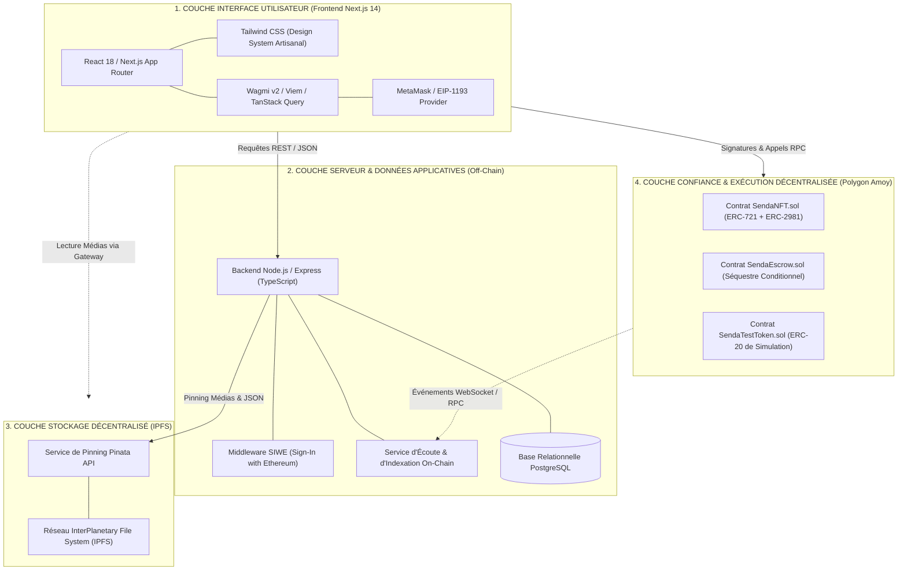

# SENDA — TECHNICAL REQUIREMENTS DOCUMENT (TRD)
**Spécifications des Exigences Techniques et Architecture Système**  
**Projet :** SENDA — Marketplace décentralisée de l'artisanat congolais  
**Version :** 1.0 — Architecture de Référence  
**Document source :** `PLANSENDA.pdf` (Chapitre 3)  
**Auteurs :** Équipe Projet SENDA (Groupe 02 — Master 1 Informatique)  

---

## 1. Vue d'ensemble de l'architecture technique

La plateforme **SENDA** repose sur une architecture décentralisée hybride organisée en quatre couches logiques complémentaires :



---

## 2. Justification rationnelle des choix technologiques

| Composant | Technologie retenue | Justification technique et opérationnelle |
| :--- | :--- | :--- |
| **Framework Frontend** | **Next.js 14 (App Router) + React** | Rendu hybride (Server Components pour l'indexation SEO du catalogue public, Client Components pour les formulaires Web3 dynamiques). Écosystème TypeScript natif robuste. |
| **Stylisation** | **Tailwind CSS v3** | Conception d'un système de design sur mesure aux teintes artisanales (Vert profond, Ocre, Beige), sans surcharge de bundles et avec support responsive complet. |
| **Bibliothèque Web3** | **Wagmi v2 + Viem** | Standard moderne de l'écosystème Ethereum. Remplacement performant et fortement typé d'ethers.js v5. Gestion automatisée de la réactivité des comptes et des changements de chaîne. |
| **Réseau Blockchain** | **Polygon Amoy Testnet (Chain ID 80002)** | Réseau de test officiel de Polygon (successeur de Mumbai). Frais d'exécution quasi nuls (gas minime), finalité rapide des transactions (2 secondes par bloc), parfaite compatibilité EVM. |
| **Langage Smart Contracts** | **Solidity `^0.8.24`** | Version mature disposant de protections natives contre les débordements arithmétiques (*overflow/underflow*), optimisations Yul et compatibilité avec les standards OpenZeppelin v5. |
| **Bibliothèque de Contrats** | **OpenZeppelin Contracts v5** | Bibliothèque éprouvée et auditée pour les standards ERC-721 (`ERC721URIStorage`), ERC-2981 (`ERC2981`), contrôles de réentrance (`ReentrancyGuard`) et gestion des propriétaires (`Ownable`). |
| **Environnement Blockchain** | **Hardhat** | Environnement de développement et de test unifié en TypeScript. Déploiement automatisé, génération de types via Typechain et simulation de nœud local rapide. |
| **Stockage Décentralisé** | **IPFS via Pinata** | Hébergement décentralisé garantissant l'intégrité des photographies et des manifestes de métadonnées sans point unique de défaillance, couplé à un SLA de pinning professionnel. |
| **Serveur Backend** | **Node.js + Express (TypeScript)** | Architecture en couches légère, performante et découplée, idéale pour l'exposition d'APIs REST, l'authentification cryptographique et l'indexation asynchrone des événements. |
| **Base de Données** | **PostgreSQL 15+** | Moteur relationnel robuste garantissant l'intégrité transactionnelle ACID, le support des index UUID, le typage JSONB pour les métadonnées et la scalabilité des requêtes du catalogue. |

---

## 3. Architecture détaillée du Frontend

L'application web est structurée selon l'App Router de Next.js sous le répertoire `apps/web/` :

```
apps/web/
├── app/
│   ├── layout.tsx             # Layout global, Providers (Wagmi, QueryClient, Toaster)
│   ├── page.tsx               # Accueil & Vitrine du catalogue artisanal
│   ├── create/
│   │   └── page.tsx           # Studio de publication pour artisan certifié
│   ├── my-nfts/
│   │   └── page.tsx           # Espace utilisateur : Commandes & Oeuvres gérées
│   └── nft/
│       └── [id]/
│           └── page.tsx       # Fiche produit détaillée & déclencheur du séquestre
├── components/
│   ├── Navbar.tsx             # Barre de navigation, sélecteur de réseau, bouton de connexion
│   ├── Footer.tsx             # Pied de page institutionnel & mentions légales
│   ├── NFTCard.tsx            # Carte produit avec statut de vérification
│   ├── EscrowModal.tsx        # Modale de dépôt sous séquestre (Approve + Deposit)
│   ├── ReleaseModal.tsx       # Modale de confirmation de réception physique
│   └── Providers.tsx          # Wrapper des contextes React (WagmiConfig, QueryClient)
└── lib/
    ├── wagmi.ts               # Configuration Viem/Wagmi (chaîne Amoy par défaut)
    ├── contracts/
    │   ├── abis.ts            # Définition des interfaces ABI (SendaNFT, SendaEscrow, SendaToken)
    │   └── addresses.ts       # Adresses des contrats déployés par environnement
    └── utils.ts               # Formateurs d'adresses, passerelle IPFS, calculs de prix
```

### 3.1. Gestion des états Web3
* **Connexion au portefeuille :** Gérée via les connecteurs Wagmi (`injected` pour MetaMask).
* **Détection du réseau :** Le client surveille le `chainId`. Si l'utilisateur n'est pas sur Polygon Amoy (`80002`), une invite de basculement automatique (*wallet_switchEthereumChain*) est envoyée.
* **Gestion des transactions asynchrones :** Utilisation conjointe de `useWriteContract` et `useWaitForTransactionReceipt` pour afficher un retour visuel en trois temps :
  1. *En attente de signature* (invite dans MetaMask).
  2. *En cours de confirmation* (minage du bloc sur Polygon Amoy).
  3. *Succès confirmé* (mise à jour de l'UI et déclenchement des effets d'indexation).

---

## 4. Architecture détaillée du Backend API et Base de Données

Le backend applicatif est un service indépendant situé sous `backend/` :

```
backend/
├── src/
│   ├── config/                # Connexion DB PostgreSQL, clients Web3 & Pinata
│   ├── controllers/           # Contrôleurs HTTP (Artworks, Orders, Users, Health)
│   ├── middleware/            # Authentification SIWE, validation Zod, logs Winston
│   ├── routes/                # Déclaration des routes REST
│   ├── services/              # Logique métier, téléversement IPFS, écoute d'événements
│   └── server.ts              # Point d'entrée de l'application Express
├── prisma/                    # Schéma de base de données & migrations
└── package.json
```

### 4.1. Principe de non-substitution
> [!IMPORTANT] Règle d'or de l'API Backend
> **Le backend SENDA ne détient aucune clé privée d'utilisateur et ne peut jamais signer de transaction financière à sa place.**
> Les transactions de minting, d'approbation de jetons, de séquestre et de libération de fonds sont **exclusivement initiées et signées par le portefeuille de l'utilisateur** dans son navigateur.
> Le rôle du backend se limite à :
> 1. Servir le catalogue indexé avec rapidité et filtres avancés.
> 2. Gérer le téléversement certifié des images et métadonnées sur IPFS.
> 3. Enregistrer les informations d'audit des artisans et des œuvres.
> 4. Indexer les événements blockchain émis pour synchroniser la base PostgreSQL.

### 4.2. Authentification cryptographique SIWE (Sign-In with Ethereum)
Pour accéder aux routes protégées (ex: soumission d'un profil artisan, mise à jour des coordonnées d'expédition off-chain), SENDA utilise la norme **EIP-4361 (SIWE)** :
1. Le backend fournit un nonce aléatoire à usage unique.
2. L'utilisateur signe un message normalisé contenant le nonce, l'adresse du portefeuille et l'horodatage.
3. Le middleware backend vérifie la signature cryptographique via `viem/verifyMessage`.
4. Si la signature est valide, un jeton de session JWT sécurisé (durée de validité : 24h) est délivré dans un cookie `HttpOnly`.

---

## 5. Gestion du stockage décentralisé (IPFS / Pinata)

### 5.1. Schéma de métadonnées standardisé
Pour assurer une compatibilité totale avec les standards NFT et les explorateurs, le manifeste JSON stocké sur IPFS respecte le format standard OpenSea / EIP-721 enrichi des spécificités artisanales congolaises :

```json
{
  "name": "Masque Pende Mbuya",
  "description": "Masque traditionnel sculpté à la main en bois de wengé, utilisé lors des cérémonies d'initiation Mukanda dans la province du Kwilu. Pigments naturels et fibres de raphia.",
  "image": "ipfs://bafybeic7v6examplehashcid/image.jpg",
  "external_url": "https://senda-artisanat.cd/artworks/550e8400-e29b-41d4-a716-446655440000",
  "attributes": [
    { "trait_type": "Catégorie", "value": "Sculpture sur bois" },
    { "trait_type": "Ethnie / Tradition", "value": "Pende" },
    { "trait_type": "Province d'origine", "value": "Kwilu" },
    { "trait_type": "Matière principale", "value": "Bois de wengé" },
    { "trait_type": "Matière secondaire", "value": "Fibres végétales de raphia" },
    { "trait_type": "Dimensions", "value": "35 x 22 x 15 cm" },
    { "trait_type": "Poids estimé", "value": "1.4 kg" },
    { "trait_type": "Année de création", "value": 2026 },
    { "trait_type": "Statut vérification artisan", "value": "Audité sur site" },
    { "trait_type": "Niveau de traçabilité", "value": "Certificat Numérique SENDA" }
  ]
}
```

### 5.2. Pipeline de publication
1. L'image de l'œuvre est soumise via un flux multipart à l'endpoint sécurisé `/api/artworks/:id/metadata`.
2. Le service backend transmet le buffer binaire à l'API Pinata (`pinFileToIPFS`).
3. L'URI IPFS de l'image est générée : `ipfs://<IMAGE_CID>`.
4. Le service génère le document JSON ci-dessus intégrant `image: ipfs://<IMAGE_CID>` et le pinne via `pinJSONToIPFS`.
5. L'URI du manifeste complet est retournée au frontend : `ipfs://<METADATA_CID>`.
6. Le frontend utilise cette URI comme argument `tokenURI` lors de l'appel au smart contract `SendaNFT.mintNFT()`.

---

## 6. Règles de sécurité et politiques de protection

1. **Protection contre la réentrance (ReentrancyGuard) :**
   Tous les transferts de fonds dans `SendaEscrow.sol` et `SendaMarketplace.sol` utilisent le modificateur `nonReentrant` d'OpenZeppelin et appliquent strictement le patron *Checks-Effects-Interactions* (mutation de l'état interne avant tout appel externe).
2. **Cloisonnement des flux financiers :**
   Les jetons de paiement sous séquestre sont consignés sur le solde du smart contract. Aucun tiers ni administrateur ne peut transférer ces fonds arbitrairement.
3. **Protection contre le débordement et manipulations :**
   Compilation avec Solidity `0.8.24` garantissant l'échec automatique (*revert*) de tout débordement mathématique.
4. **Validation stricte des entrées API :**
   Toutes les charges utiles entrantes (payloads) sont validées par des schémas de validation stricts (Zod) pour éradiquer les injections SQL et les attaques par altération d'objets.
5. **Gestion étanche des secrets d'environnement :**
   Les clés privées des comptes de déploiement et les clés d'API Pinata sont exclusivement chargées via des variables d'environnement non versionnées (`.env`), avec un modèle d'exemple fourni dans `.env.example`.
6. **Zéro Donnée Personnelle On-Chain :**
   Les identités civiles, numéros de téléphone et adresses physiques postales des acheteurs et artisans sont strictement proscrits des métadonnées publiques IPFS et des paramètres de transactions blockchain.
