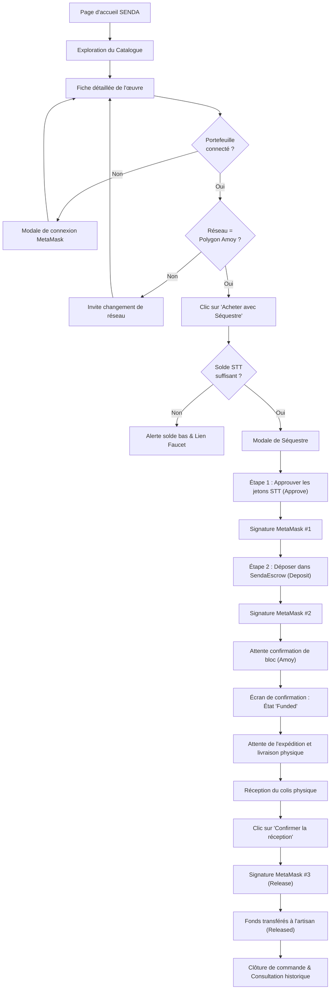
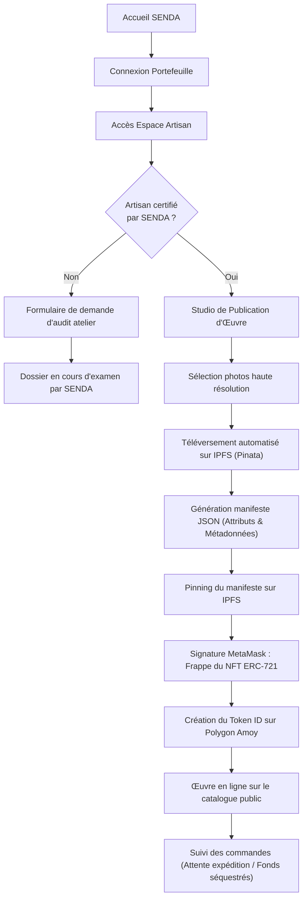

# SENDA — DESIGN SYSTEM & DOCUMENTATION UI/UX
**Charte Graphique, Expérience Utilisateur et Parcours de Navigation**  
**Projet :** SENDA — Marketplace décentralisée de l'artisanat congolais  
**Version :** 1.0 — Spécifications Design & Ergonomie  
**Document source :** `PLANSENDA.pdf` (Chapitre 6)  
**Auteurs :** Équipe Projet SENDA (Groupe 02 — Master 1 Informatique)  

---

## 1. Identité visuelle et intention créative

L'identité visuelle de **SENDA** a été conçue pour fusionner deux univers complémentaires :
* **L'authenticité et la noblesse de la terre et de l'artisanat congolais :** Évoquer les bois précieux (wengé, ébène), les fibres de raphia, l'argile, le cuivre et la malachite.
* **La rigueur et la transparence de l'ingénierie logicielle décentralisée :** Une interface sobre, épurée et moderne, inspirant confiance, sans l'austérité ni le côté "cryptographique sombre" des plateformes Web3 conventionnelles.

---

## 2. Palette chromatique officielle

Conformément au document de cadrage `PLANSENDA.pdf` (Figure 6.1), la charte graphique s'articule autour de trois teintes maîtresses, enrichies de teintes sémantiques de retour d'état :

```
┌────────────────────────┐  ┌────────────────────────┐  ┌────────────────────────┐
│      VERT PROFOND      │  │     OCRE ARTISANAL     │  │      BEIGE CLAIR       │
│        #1B4332         │  │        #C86D3B         │  │        #F8F5F0         │
│  (Stabilité & Confiance)│  │(Terre, Bois & Matière) │  │  (Clarté & Lisibilité) │
└────────────────────────┘  └────────────────────────┘  └────────────────────────┘
```

### 2.1. Spécifications détaillées des couleurs

| Nom de la couleur | Code HEX | Code HSL | Rôle principal dans l'interface | Contraste / Accessibilité |
| :--- | :---: | :---: | :--- | :--- |
| **Vert Profond** | `#1B4332` | `153°, 42%, 18%` | Couleur primaire. En-têtes, boutons d'action principale, badges institutionnels, pied de page. | Ratio > 7:1 sur fond clair (Conforme AAA). |
| **Ocre Artisanal** | `#C86D3B` | `21°, 58%, 51%` | Couleur d'accent. Boutons de séquestre, badges d'œuvres certifiées, indicateurs de mise en avant. | Ratio > 4.5:1 sur fond blanc/beige (Conforme AA). |
| **Beige Clair** | `#F8F5F0` | `38°, 33%, 96%` | Couleur d'arrière-plan globale. Apporte douceur, évite l'éblouissement du blanc pur `#FFFFFF`. | Fond neutre chaleureux. |
| **Brun Ébène** | `#2D231E` | `22°, 20%, 15%` | Typographie principale, titres de section, bordures structurantes. | Excellente lisibilité typographique. |
| **Or Pâle (Surbrillance)**| `#E9C46A` | `43°, 74%, 66%` | Étoiles de notation, rappels de métaux précieux (cuivre/laiton). | Éléments décoratifs et highlights. |
| **Ambre Alerte (Séquestre)**| `#D97706` | `38°, 92%, 44%` | Indicateur d'état `Funded` (Fonds bloqués sous séquestre). | Signal d'attente d'action. |
| **Vert Émeraude Succès** | `#16A34A` | `142°, 76%, 36%` | Indicateur d'état `Released` (Fonds libérés / Réception confirmée). | Confirmation de réussite. |

---

## 3. Typographie et hiérarchie de texte

Pour conjuguer prestige patrimonial et rigueur fonctionnelle, deux familles de polices Google Fonts sont retenues :

* **Titres & Identité :** *Cinzel* ou *Playfair Display* (Serif). Confère aux œuvres artisanales une stature muséale et une élégance intemporelle.
* **Corps de texte & Données techniques :** *Plus Jakarta Sans* ou *Inter* (Sans-serif). Optimisée pour les écrans, garantissant une lisibilité maximale pour les adresses de portefeuilles, montants chiffrés et descriptions de fabrication.
* **Adresses cryptographiques & Hachages :** *JetBrains Mono* ou *Fira Code* (Monospace). Dédiée à l'affichage des adresses (`0x...`), des identifiants IPFS (`ipfs://...`) et des hachages de transactions.

---

## 4. Architecture de l'information et navigation globale

Le menu de navigation principal (`Navbar`) s'adapte dynamiquement selon l'état de connexion de l'utilisateur et son rôle vérifié :

```
[ LOGO SENDA ]   Catalogue   Artisans du Congo   Notre Démarche   │   [Rechercher une oeuvre...]   │   [Connecter Portefeuille]
```

Une fois le portefeuille connecté :
* **Visiteur classique :** Affiche l'adresse tronquée (`0x71C...4b9`), le réseau (`Polygon Amoy`), le solde en jetons de test (`150 STT`) et un bouton vers « Mes Commandes ».
* **Artisan vérifié :** Ajoute un accès prioritaire vers l'« Espace Artisan » (Publication d'œuvres, gestion des commandes à expédier, historique des ventes).

---

## 5. Description détaillée des pages et composants clés

### 5.1. Page d'Accueil (`/`)
* **Hero Section :** Image immersive d'un artisan sculpteur à l'œuvre à Kinshasa, slogan *« L'artisanat congolais, authentifié et valorisé »*, bouton d'appel à l'action *« Explorer le catalogue »* et bouton secondaire *« Devenir artisan certifié »*.
* **Bandeau de Réassurance :** Trois piliers mis en exergue :
  1. *Artisanat Authentifié* (Audit physique des ateliers).
  2. *Paiement Sécurisé* (Séquestre décentralisé jusqu'à réception).
  3. *Certificat Numérique Immuable* (NFT ERC-721 stocké sur IPFS).
* **Sélection d'Œuvres Vedettes :** Carrousel des pièces maîtresses récentes avec badge de province (ex: Bandundu, Kasaï, Katanga).
* **Section Pédagogique Web3 :** Explication vulgarisée du mécanisme de séquestre en 3 étapes simples pour rassurer les néophytes.

### 5.2. Catalogue public et filtres (`/catalogue`)
* **Barre d'outils supérieure :** Champ de recherche textuelle, tri par prix (croissant / décroissant), tri par ancienneté, tri par popularité.
* **Panneau latéral de filtres :**
  * *Catégories :* Sculptures sur bois, Textiles et Vannerie, Peinture & Toiles, Bijouterie & Métaux, Céramique.
  * *Régions de RDC :* Grand Kinshasa, Kongo Central, Grand Kasaï, Grand Bandundu, Kivu, Grand Katanga, Province Orientale.
  * *Gamme de prix :* Curseur dynamique en jetons `STT`.
  * *Niveau de certification :* « Œuvre vérifiée par SENDA ».
* **Grille de cartes d'œuvres (`NFTCard`) :**
  * Image en haute résolution avec ratio 4:3 et indicateur de chargement skeleton.
  * Titre de l'œuvre et nom de l'artisan avec pastille de vérification verte.
  * Prix en gros caractères avec l'icône de jeton et la mention obligatoire `STT (Jeton de test)`.
  * Badge d'état de disponibilité (`Disponible`, `En cours de livraison / Séquestrée`, `Vendue`).

### 5.3. Fiche détaillée d'une œuvre (`/nft/[id]`)
La fiche produit applique scrupuleusement la règle de transparence imposée par `PLANSENDA.pdf` : **distinguer nettement les trois niveaux d'information** :

```
┌────────────────────────────────────────────────────────────────────────┐
│                        FICHE DÉTAILLÉE D'UNE ŒUVRE                     │
├──────────────────────────────────┬─────────────────────────────────────┤
│                                  │ [Badge : ARTISAN VÉRIFIÉ PAR SENDA] │
│                                  │ Masque Royal Pende - Mbuya          │
│                                  │ Par Maître Mukendi (Kinshasa)       │
│                                  │                                     │
│         GALERIE PHOTOS           │ Prix : 150.00 STT (Jeton de test)   │
│           HAUTE DÉFINITION       │                                     │
│         (Stockée sur IPFS)       ├─────────────────────────────────────┤
│                                  │ 1. DONNÉES DÉCLARÉES PAR L'ARTISAN  │
│                                  │ • Matériau : Bois de wengé          │
│                                  │ • Période : 2026                    │
│                                  │ • Dimensions : 35 x 22 x 15 cm      │
│                                  │                                     │
│                                  │ 2. DONNÉES AUDITÉES PAR SENDA       │
│                                  │ • Contrôle atelier : Réalisé        │
│                                  │ • Origine : Province du Kwilu       │
│                                  │                                     │
│                                  │ 3. ENREGISTREMENT SUR LA BLOCKCHAIN │
│                                  │ • Réseau : Polygon Amoy             │
│                                  │ • Contrat NFT : 0x123...abc         │
│                                  │ • Token ID : #42                    │
│                                  │ • Métadonnées : ipfs://bafy...      │
│                                  ├─────────────────────────────────────┤
│                                  │ [ BOUTON : ACHETER AVEC SÉQUESTRE ] │
│                                  │ (Fonds bloqués jusqu'à réception)   │
└──────────────────────────────────┴─────────────────────────────────────┘
```

### 5.4. Espace Commandes et Séquestre (`/my-orders`)
Présente l'historique complet des engagements avec une barre de progression visuelle en 4 étapes :
1. `Commande initiée` -> 2. `Paiement séquestré (Funded)` -> 3. `Colis en transit` -> 4. `Réception confirmée & Fonds libérés (Released)`.
* Un bouton d'action contextuel bien en vue : **« Confirmer la bonne réception du colis »**.
* Un volet rétractable affichant les identifiants techniques : Hachage de la transaction de dépôt, hachage de libération, liens vers Polygonscan.

---

## 6. Diagrammes des parcours utilisateurs (AppFlow)

### 6.1. Parcours de l'Acheteur
Le flux ci-dessous modélise l'ensemble des écrans et des décisions rencontrés par l'acheteur :



### 6.2. Parcours de l'Artisan
Le flux modélise la publication et la gestion des créations par l'artisan :



---

## 7. Principes UX et gestion des états d'interface

1. **Information claire sur la nature de simulation :**
   Tous les montants sont libellés en `STT` (Senda Test Token) et un bandeau discret mais visible informe les testeurs : *"Vous êtes sur le réseau de simulation Polygon Amoy. Les fonds utilisés sont des jetons de test sans valeur monétaire réelle."*
2. **Jamais de statut prématuré :**
   Une commande ne s'affiche jamais comme « Payée » tant que la transaction blockchain n'a pas été incluse dans un bloc miné et confirmée avec au moins 1 confirmation.
3. **Double confirmation des actes irréversibles :**
   La confirmation de réception physique (`confirmReceiptAndRelease`) libérant définitivement les fonds sans possibilité de retour arrière fait l'objet d'une modale de confirmation explicite avec case à cocher : *« J'atteste avoir reçu l'œuvre en bon état et conforme aux spécifications »*.
4. **Visibilité du statut de vérification :**
   Le badge « Artisan vérifié » n'est affiché que si la clé cryptographique correspond à une entrée validée dans le registre des artisans certifiés.
5. **Accessibilité et conception mobile-first :**
   L'interface est entièrement responsive, testée pour les résolutions mobiles (375px et plus), assurant un usage fluide sur smartphones pour les artisans sur le terrain à Kinshasa.
