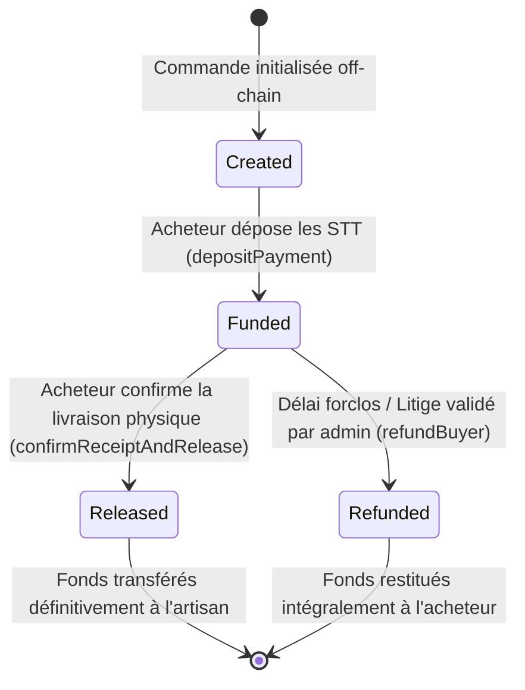
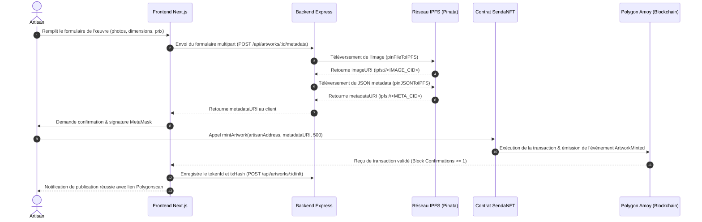
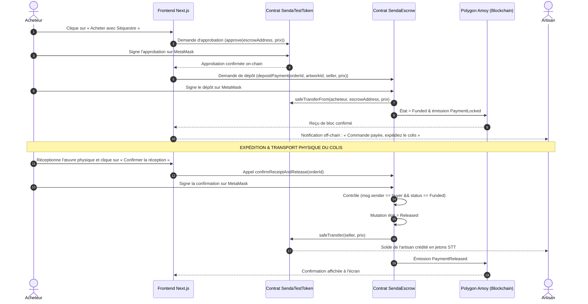

# SENDA — ARCHITECTURE BLOCKCHAIN & CONTRATS INTELLIGENTS
**Spécifications des Smart Contracts, du Protocole de Séquestre et des Standards de Jetons**  
**Projet :** SENDA — Marketplace décentralisée de l'artisanat congolais  
**Version :** 1.0 — Architecture On-Chain  
**Document source :** `PLANSENDA.pdf` (Chapitres 3, 4 et 8)  
**Auteurs :** Équipe Projet SENDA (Groupe 02 — Master 1 Informatique)  

---

## 1. Vue d'ensemble de l'architecture on-chain

L'architecture blockchain de **SENDA** est déployée sur le réseau de test **Polygon Amoy (Chain ID : `80002`)**. Elle est constituée de trois contrats intelligents Solidity autonomes, modulaires et interopérables :

```
┌─────────────────────────────────────────────────────────────────────────────┐
│                       ÉCOSYSTÈME ON-CHAIN SENDA                             │
├──────────────────────────┬────────────────────────────┬─────────────────────┤
│      1. SendaNFT.sol     │     2. SendaEscrow.sol     │3. SendaTestToken.sol│
│  (Certificat d'Enreg.)   │   (Séquestre Physique)     │ (Moyen de Paiement) │
├──────────────────────────┼────────────────────────────┼─────────────────────┤
│ • Standard ERC-721       │ • Rétention conditionnelle │ • Standard ERC-20   │
│ • Extension URIStorage   │ • Machine à états formelle │ • Faucet de testnet │
│ • Redevances ERC-2981    │ • Anti-réentrance          │ • Décimales : 18    │
│ • Rôle ARTISAN_MINTER    │ • Protection acheteur/art. │ • Symbole : STT     │
└──────────────────────────┴────────────────────────────┴─────────────────────┘
```

---

## 2. Spécification détaillée des contrats intelligents

### 2.1. Contrat `SendaNFT.sol` (Certificat d'Enregistrement Numérique)
* **Standards implémentés :** ERC-721 (`ERC721URIStorage`), ERC-2981 (`IERC2981`), `Ownable`, `Pausable`.
* **Rôle :** Représenter l'enregistrement immuable de l'œuvre artisanale sur le registre public décentralisé.
* **Gestion des métadonnées :** Chaque jeton pointe vers un CID IPFS (`ipfs://<CID>/metadata.json`) contenant la description complète, les photographies, la province d'origine, les matériaux et le badge de conformité.
* **Support des redevances d'artisan (ERC-2981) :**
  Lors de la création du NFT, l'artisan est enregistré comme bénéficiaire d'une redevance sur les reventes secondaires (configurée par défaut à 500 points de base, soit 5.0%, plafonnée à un maximum strict de 10%).

#### Interface technique principale de `SendaNFT` :
```solidity
interface ISendaNFT {
    event ArtworkMinted(
        uint256 indexed tokenId,
        address indexed artisan,
        string tokenURI,
        uint96 royaltyFeeBps
    );

    function mintArtwork(
        address artisanRecipient,
        string calldata metadataURI,
        uint96 royaltyFeeBps
    ) external returns (uint256 tokenId);

    function royaltyInfo(
        uint256 tokenId,
        uint256 salePrice
    ) external view returns (address receiver, uint256 royaltyAmount);

    function pause() external;
    function unpause() external;
}
```

---

### 2.2. Contrat `SendaTestToken.sol` (Devise de Simulation Économique)
* **Standard implémenté :** ERC-20 (`ERC20`, `Ownable`).
* **Nom du jeton :** *Senda Test Token*.
* **Symbole :** `STT`.
* **Raison d'être :** Permettre l'exécution intégrale des tests de paiement et de séquestre sur Polygon Amoy sans imposer aux testeurs ou évaluateurs l'achat de cryptomonnaies réelles.
* **Fonction Faucet :**
  Le contrat intègre une méthode publique `faucet(address recipient, uint256 amount)` bridée (par exemple 100 STT maximum toutes les 24h par adresse) pour approvisionner immédiatement tout nouveau portefeuille visiteur.

---

### 2.3. Contrat `SendaEscrow.sol` (Séquestre Conditionnel de Paiement Physique)
Le contrat de séquestre est le **pivot central de la confiance** dans SENDA. Contrairement à une place de marché NFT purement numérique où la livraison est instantanée (swap atomique), un marché artisanal implique l'emballage, le transport terrestre et la réception physique du colis par l'acheteur.

#### Machine à états formelle d'une commande sous séquestre :


#### Structure de données On-Chain (`Order`) :
```solidity
enum OrderStatus { NonExistent, Created, Funded, Released, Refunded }

struct Order {
    bytes32 orderId;         // Identifiant unique de commande (hachage UUID off-chain)
    uint256 artworkTokenId;  // Token ID du NFT associé
    address buyer;           // Adresse du portefeuille de l'acheteur
    address seller;          // Adresse du portefeuille de l'artisan créateur
    uint256 amount;          // Montant du prix en jetons STT (en Wei)
    OrderStatus status;      // État courant de la commande
    uint256 fundedAt;        // Horodatage du bloc lors du dépôt
    uint256 releasedAt;      // Horodatage du bloc lors de la libération
}
```

#### Règles d'intégrité et de contrôle d'accès :
1. **Dépôt des fonds (`depositPayment`) :**
   * L'acheteur doit au préalable avoir approuvé le contrat de séquestre via `SendaTestToken.approve(escrowAddress, amount)`.
   * Le contrat exécute `safeTransferFrom(msg.sender, address(this), amount)`.
   * Le statut de la commande passe irréversiblement à `Funded`.
   * L'œuvre est marquée comme verrouillée pour empêcher tout double achat concurrent.
2. **Confirmation et libération (`confirmReceiptAndRelease`) :**
   * **Contrôle d'accès strict :** `require(msg.sender == order.buyer, "Seul l'acheteur peut valider la reception");`
   * **Contrôle d'état :** `require(order.status == OrderStatus.Funded, "La commande n'est pas financee");`
   * **Mutation préalable (Checks-Effects-Interactions) :** `order.status = OrderStatus.Released;`
   * **Transfert sécurisé :** Le contrat transfère `order.amount` au `seller` via `safeTransfer`.
   * **Émission d'événement :** Émet `PaymentReleased(orderId, order.seller, order.amount)`.
3. **Protection contre la réentrance :**
   Toutes les fonctions avec transfert de jetons sont décorées par `nonReentrant`.
4. **Gestion des litiges et cas d'échec :**
   En cas de colis perdu ou avéré non expédié, une fonction de remboursement sous clause d'administration ou après expiration d'un délai de forclusion prédéfini (ex: 30 jours sans confirmation) permet de restituer les jetons à l'acheteur (`refundBuyer`).

---

## 3. Diagrammes de séquence des opérations on-chain

### 3.1. Séquence de publication, téléversement IPFS et minting
Ce diagramme détaille le flux nominal conforme à la Figure 8.1 de `PLANSENDA.pdf` :



### 3.2. Séquence d'achat physique, séquestre et libération des fonds
Ce diagramme détaille le cycle financier complet conforme à la Figure 8.2 de `PLANSENDA.pdf` :



---

## 4. Analyse critique du standard de redevances ERC-2981

Le contrat `SendaNFT.sol` implémente rigoureusement l'interface `IERC2981` via la fonction :
```solidity
function royaltyInfo(uint256 tokenId, uint256 salePrice)
    external view override returns (address receiver, uint256 royaltyAmount);
```

### Limites réelles et transparence technique :
> [!WARNING] Règle d'or de l'ERC-2981
> **Le standard ERC-2981 est une interface déclarative d'information et non un mécanisme de prélèvement forcé au niveau de la machine virtuelle Ethereum.**
> Lorsque l'œuvre est revendue :
> 1. Si la revente a lieu au sein de la marketplace SENDA, le smart contract interroge `royaltyInfo` et déduit automatiquement les 5% au profit de l'artisan d'origine.
> 2. Si la revente a lieu sur une plateforme tierce externe (OpenSea, Rarible), celle-ci est libre d'honorer ou d'ignorer la redevance, à moins que le contrat n'intègre un registre de blocage d'opérateurs (*Operator Filter Registry*).
> Cette distinction technique est explicitement documentée pour maintenir une totale honnêteté intellectuelle face aux évaluateurs académiques.

---

## 5. Mesures de sécurité des contrats et plan d'audit

1. **Vérification de l'accès aux fonctions critiques :**
   * La mise en pause d'urgence (`pause()` / `unpause()`) est réservée au propriétaire du contrat (`onlyOwner`).
   * La confirmation de réception est strictement réservée à l'adresse de l'acheteur authentique (`msg.sender == order.buyer`).
2. **Audit statique via Slither :**
   * Exécution planifiée de l'analyseur statique de sécurité **Slither** pour détecter d'éventuelles vulnérabilités :
     * Détection d'appels réentrants (`reentrancy-benign`, `reentrancy-eth`).
     * Variables d'état non initialisées.
     * Respect strict des conventions de visibilité (`public`, `external`, `internal`, `private`).
3. **Couverture de tests unitaires Hardhat :**
   * Tests des flux nominaux (mint, approve, deposit, release).
   * Tests des scénarios d'attaque (re-dépôt, double libération, tentative de retrait par un non-acheteur, tentative de mint sans rôle vérifié).
