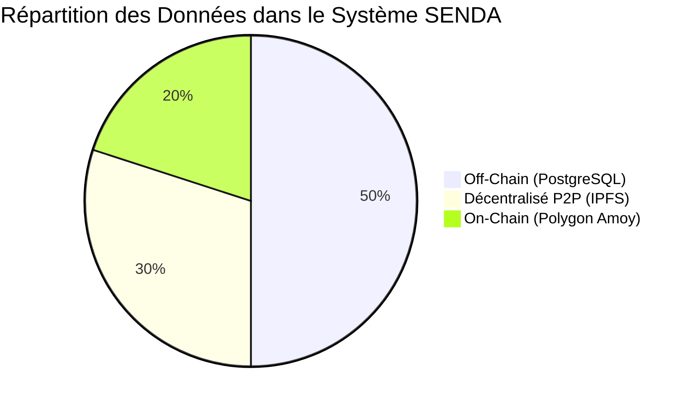
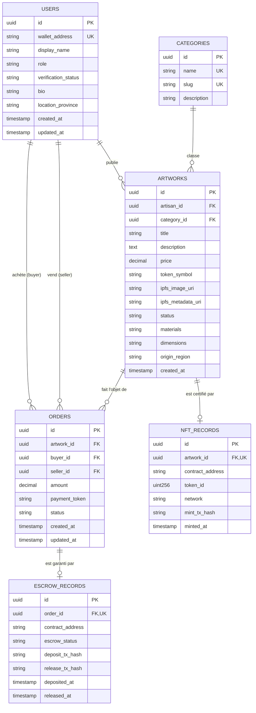

# SENDA — MODÈLE DE DONNÉES ET SPÉCIFICATIONS DES API
**Architecture de Données Hybride, Dictionnaire de Base de Données et Contrats d'Interface REST**  
**Projet :** SENDA — Marketplace décentralisée de l'artisanat congolais  
**Version :** 1.0 — Spécifications Backend & Données  
**Document source :** `PLANSENDA.pdf` (Chapitre 7)  
**Auteurs :** Équipe Projet SENDA (Groupe 02 — Master 1 Informatique)  

---

## 1. Répartition stratégique des espaces de données

Pour conjuguer décentralisation, performance et confidentialité, le système **SENDA** cloisonne rigoureusement les données en trois espaces de persistance étanches :



1. **Espace Applicatif Off-Chain (Base PostgreSQL) :**
   Héberge les informations relationnelles, les profils d'utilisateurs, les textes descriptifs enrichis, les données d'audit des artisans, les états de commande intermédiaires et les index de recherche rapide.
2. **Espace Décentralisé P2P (Réseau IPFS / Pinata) :**
   Héberge les photographies en haute résolution des créations artisanales et le manifeste JSON standardisé garantissant l'immuabilité du contenu numérique.
3. **Espace de Confiance On-Chain (Blockchain Polygon Amoy) :**
   Héberge les contrats intelligents, le registre des propriétaires de jetons ERC-721, le solde des fonds consignés sous séquestre (`SendaEscrow`) et les événements immuables audités.

---

## 2. Modèle Conceptuel et Entité-Association (ERD)

Le schéma relationnel est modélisé comme suit :



---

## 3. Dictionnaire de données détaillé des tables PostgreSQL

### 3.1. Table `users`
Enregistre les utilisateurs de la plateforme (acheteurs, visiteurs réguliers, artisans créateurs et administrateurs).
* `id` : `UUID`, Clé primaire générée par `gen_random_uuid()`.
* `wallet_address` : `VARCHAR(42)`, Unique, non nul. Adresse Ethereum normalisée en minuscules (`0x...`).
* `display_name` : `VARCHAR(100)`, Nom d'usage ou nom de l'atelier de l'artisan.
* `role` : `VARCHAR(20)`, Valeurs autorisées : `'VISITOR'`, `'BUYER'`, `'ARTISAN'`, `'ADMIN'`. Défaut : `'BUYER'`.
* `verification_status` : `VARCHAR(20)`, Statut de certification de l'artisan. Valeurs : `'UNVERIFIED'`, `'PENDING'`, `'VERIFIED'`, `'REJECTED'`. Défaut : `'UNVERIFIED'`.
* `bio` : `TEXT`, Présentation de l'artisan, démarche artistique et savoir-faire traditionnel.
* `location_province` : `VARCHAR(100)`, Province de rattachement en RDC (ex: Kinshasa, Kwilu, Kasaï-Oriental).
* `created_at` : `TIMESTAMP WITH TIME ZONE`, Date d'enregistrement initial.

### 3.2. Table `categories`
Référentiel des catégories de l'artisanat congolais.
* `id` : `UUID`, Clé primaire.
* `name` : `VARCHAR(50)`, Nom public (ex: "Sculpture sur bois", "Textile & Raphia", "Bijouterie en malachite").
* `slug` : `VARCHAR(50)`, Identifiant URL unique (ex: "sculpture-bois", "textile-raphia").
* `description` : `TEXT`, Descriptif patrimonial de la catégorie.

### 3.3. Table `artworks`
Répertoire exhaustif des créations artisanales soumises sur SENDA.
* `id` : `UUID`, Clé primaire.
* `artisan_id` : `UUID`, Clé étrangère vers `users(id)`, non nul.
* `category_id` : `UUID`, Clé étrangère vers `categories(id)`, non nul.
* `title` : `VARCHAR(150)`, Titre de l'œuvre (ex: "Masque Pende Mbuya").
* `description` : `TEXT`, Récit de création, fonction rituelle ou symbolique.
* `price` : `NUMERIC(18, 4)`, Prix fixé en jetons de simulation, non nul.
* `token_symbol` : `VARCHAR(10)`, Devise applicable. Défaut : `'STT'`.
* `ipfs_image_uri` : `VARCHAR(255)`, URI du fichier image principal (`ipfs://<CID>`).
* `ipfs_metadata_uri` : `VARCHAR(255)`, URI du fichier JSON de métadonnées complet.
* `materials` : `VARCHAR(200)`, Matériaux employés (ex: "Bois d'ébène, pigments minéraux, cauris").
* `dimensions` : `VARCHAR(100)`, Dimensions physiques (ex: "45 x 20 x 18 cm").
* `origin_region` : `VARCHAR(100)`, Région ou ethnie d'inspiration (ex: "Kwilu / Pende").
* `status` : `VARCHAR(20)`, Valeurs : `'DRAFT'`, `'PUBLISHED'`, `'RESERVED'`, `'SOLD'`. Défaut : `'DRAFT'`.
* `created_at` : `TIMESTAMP WITH TIME ZONE`, Date de création.

### 3.4. Table `nft_records`
Conserve le lien cryptographique officiel entre la fiche d'œuvre physique et son jeton ERC-721.
* `id` : `UUID`, Clé primaire.
* `artwork_id` : `UUID`, Clé étrangère unique vers `artworks(id)`.
* `contract_address` : `VARCHAR(42)`, Adresse du contrat `SendaNFT` déployé sur Polygon Amoy.
* `token_id` : `NUMERIC(78, 0)`, Numéro de jeton unique (`uint256` Solidity).
* `network` : `VARCHAR(50)`, Réseau blockchain (ex: `'polygon-amoy'`).
* `mint_tx_hash` : `VARCHAR(66)`, Hachage de la transaction de frappe sur la blockchain.
* `minted_at` : `TIMESTAMP WITH TIME ZONE`.

### 3.5. Table `orders`
Enregistre la commande commerciale initiée par l'acheteur.
* `id` : `UUID`, Clé primaire interne de commande.
* `artwork_id` : `UUID`, Clé étrangère vers `artworks(id)`.
* `buyer_id` : `UUID`, Clé étrangère vers `users(id)` (l'acheteur).
* `seller_id` : `UUID`, Clé étrangère vers `users(id)` (l'artisan vendeur).
* `amount` : `NUMERIC(18, 4)`, Montant consigné.
* `payment_token` : `VARCHAR(10)`, Ex: `'STT'`.
* `status` : `VARCHAR(20)`, Statut commercial : `'INITIALIZED'`, `'FUNDED'`, `'SHIPPED'`, `'COMPLETED'`, `'CANCELLED'`.
* `created_at` : `TIMESTAMP WITH TIME ZONE`.

### 3.6. Table `escrow_records`
Indexe l'historique et l'état d'exécution du contrat de séquestre décentralisé pour une commande donnée.
* `id` : `UUID`, Clé primaire.
* `order_id` : `UUID`, Clé étrangère unique vers `orders(id)`.
* `contract_address` : `VARCHAR(42)`, Adresse du contrat `SendaEscrow`.
* `escrow_status` : `VARCHAR(20)`, Valeurs : `'CREATED'`, `'FUNDED'`, `'RELEASED'`, `'REFUNDED'`.
* `deposit_tx_hash` : `VARCHAR(66)`, Hachage de la transaction de dépôt des fonds.
* `release_tx_hash` : `VARCHAR(66)`, Hachage de la transaction de libération vers l'artisan.
* `deposited_at` : `TIMESTAMP WITH TIME ZONE`.
* `released_at` : `TIMESTAMP WITH TIME ZONE`.

> [!IMPORTANT] Règle de conception fondamentale sur les identifiants
> Conformément au chapitre 7 de `PLANSENDA.pdf`, **l'identifiant de transaction blockchain (`tx_hash`) ne doit jamais être utilisé seul pour identifier une commande ou une œuvre**. Un identifiant interne immuable de type `UUID` est systématiquement conservé et associé aux références cryptographiques on-chain.

---

## 4. Spécifications des Endpoints API REST

Toutes les réponses de l'API sont servies avec l'en-tête `Content-Type: application/json` et respectent une structure de réponse standardisée :
* Requête réussie : `{ "success": true, "data": { ... } }`
* Erreur : `{ "success": false, "error": { "code": "STRING_CODE", "message": "Description claire" } }`

### 4.1. `GET /api/health`
* **Description :** Vérification de l'état du serveur backend, de la connexion PostgreSQL et du nœud RPC Polygon Amoy.
* **Codes retour :**
  * `200 OK` : Système opérationnel (`{ "status": "UP", "database": "CONNECTED", "network": "amoy" }`).
  * `503 Service Unavailable` : Défaillance de la base de données ou du réseau.

### 4.2. `GET /api/artworks`
* **Description :** Liste paginée des œuvres disponibles sur le catalogue public.
* **Paramètres de requête (Query params) :**
  * `category` (optionnel) : Filtre par slug de catégorie (ex: `sculpture-bois`).
  * `minPrice` / `maxPrice` (optionnel) : Fourchette de prix en STT.
  * `artisanId` (optionnel) : Identifiant de l'artisan.
  * `page` (défaut : 1) / `limit` (défaut : 12).
* **Codes retour :**
  * `200 OK` : Liste d'œuvres avec pagination (`items`, `total`, `page`, `totalPages`).

### 4.3. `GET /api/artworks/:id`
* **Description :** Consultation complète de la fiche détaillée d'une œuvre par son UUID.
* **Codes retour :**
  * `200 OK` : Fiche détaillée incluant les données déclarées, l'enregistrement NFT (contrat, tokenId) et le statut de vérification de l'artisan.
  * `404 Not Found` : Œuvre introuvable.

### 4.4. `POST /api/artworks`
* **Description :** Création d'une ébauche de fiche d'œuvre.
* **Authentification :** Requise (SIWE JWT avec rôle `ARTISAN` et statut `VERIFIED`).
* **Corps de requête (JSON) :**
  ```json
  {
    "title": "Masque Pende Mbuya",
    "description": "Masque traditionnel en bois de wengé...",
    "categoryId": "4b68e778-d50c-4e89-8d1e-87cb46f90123",
    "price": "150.00",
    "materials": "Bois de wengé, raphia",
    "dimensions": "35 x 22 x 15 cm",
    "originRegion": "Kwilu"
  }
  ```
* **Codes retour :**
  * `201 Created` : Ébauche créée avec succès (`{ "id": "...", "status": "DRAFT" }`).
  * `400 Bad Request` : Erreur de validation de schéma (Zod).
  * `403 Forbidden` : Compte non vérifié pour publier des œuvres.

### 4.5. `POST /api/artworks/:id/metadata`
* **Description :** Téléversement des fichiers visuels et génération du manifeste JSON épinglé sur IPFS (Pinata).
* **Authentification :** Requise (Artisan propriétaire de l'œuvre).
* **Format :** `multipart/form-data` contenant le champ `image` (JPEG/PNG/WEBP, max 10 Mo).
* **Codes retour :**
  * `200 OK` : Médias et manifeste épinglés sur IPFS avec succès.
    ```json
    {
      "success": true,
      "data": {
        "imageUri": "ipfs://bafybeig.../image.jpg",
        "metadataUri": "ipfs://bafybeih.../metadata.json"
      }
    }
    ```

### 4.6. `POST /api/artisans/verification`
* **Description :** Soumission d'une demande de certification d'atelier artisanal.
* **Authentification :** Requise (Utilisateur connecté via SIWE).
* **Corps de requête :** Coordonnées de l'atelier, province, pièces justificatives, portfolio initial.
* **Codes retour :**
  * `201 Created` : Dossier enregistré avec le statut `'PENDING'`.

### 4.7. `GET /api/orders/:id`
* **Description :** Consultation de l'état d'avancement d'une commande et de son séquestre.
* **Authentification :** Requise (Accessible uniquement par l'acheteur, le vendeur ou l'administrateur).
* **Codes retour :**
  * `200 OK` : Détails de la commande, adresse du séquestre, statut on-chain indexé et transactions de dépôt/libération.

### 4.8. `GET /api/users/:wallet/orders`
* **Description :** Récupération de l'historique des commandes associées à un portefeuille donné (achats ou ventes).
* **Codes retour :**
  * `200 OK` : Liste des commandes avec état de livraison et état du séquestre.

### 4.9. `GET /api/nfts/:contract/:tokenId`
* **Description :** Consultation des informations indexées relatives à un jeton NFT précis (historique des transferts, URI, redevance déclarée).
* **Codes retour :**
  * `200 OK` : Enregistrement du jeton et métadonnées résolues.
