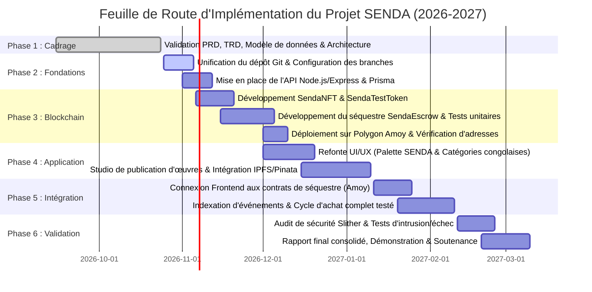

# SENDA — PLAN D'IMPLÉMENTATION & FEUILLE DE ROUTE
**Planification Opérationnelle, Jalons Techniques et Répartition des Rôles**  
**Projet :** SENDA — Marketplace décentralisée de l'artisanat congolais  
**Cadre :** Master 1 Informatique (2026–2027) — Groupe 02  
**Membres :** Kabongo Mukola Nathan | Losongo Kingombe Victor | Tuasansilu Lufuma Benie  
**Document source :** `PLANSENDA.pdf` (Chapitres 9 et 10)  
**Version :** 1.0 — Feuille de Route d'Ingénierie  

---

## 1. Diagnostic de situation et point de départ

À l'issue de l'audit de l'espace local `D:\SENDA`, le projet se situe à la charnière entre la **Phase 1 (Cadrage)** et la **Phase 2 (Fondations et restructuration)** :



---

## 2. Découpage détaillé des 6 phases de développement

### Phase 1 : Cadrage & Formalisation (Statut : TERMINÉ)
* **Travaux réalisés :** Finalisation du document de cadrage `PLANSENDA.pdf`, rédaction des spécifications d'exigences produit (PRD), des exigences techniques (TRD), des cas d'utilisation, des diagrammes de séquence et du modèle relationnel de données.
* **Livrable :** Dossier de spécifications professionnelles complet validé.

### Phase 2 : Fondations & Restructuration du Dépôt (Statut : EN COURS)
* **Travaux :**
  1. Consolider l'espace de travail sous une racine unifiée propre `senda-marketplace/` (en éliminant les scories et en isolant le prototype `Aetheria`).
  2. Structurer les branches GitHub (`main`, `develop`, `feature/frontend`, `feature/contracts`, `feature/backend-ipfs`).
  3. Mettre en place le backend API `backend/` sous Node.js/Express avec TypeScript et Prisma ORM pour PostgreSQL.
  4. Configurer les variables d'environnement globales (`.env.example`).
* **Livrable attendu :** Dépôt unifié exécutable et synchronisé.

### Phase 3 : Développement Blockchain & Smart Contracts (Responsable : Victor)
* **Travaux :**
  1. Adapter le contrat ERC-721 en `SendaNFT.sol` avec support ERC-2981 pour les créateurs congolais.
  2. Écrire le jeton ERC-20 utilitaire `SendaTestToken.sol` avec mécanisme de faucet public pour Polygon Amoy.
  3. Développer le contrat de séquestre conditionnel `SendaEscrow.sol` (Cycle `Created -> Funded -> Released / Refunded`).
  4. Rédiger une suite complète de tests automatisés sous Hardhat / Chai couvrant les scénarios nominaux et les tentatives de détournement de fonds.
  5. Déployer les trois contrats sur le testnet **Polygon Amoy** et documenter leurs adresses publiques.
* **Livrables attendus :** Code Solidity complet, 100% de tests au vert, rapport de déploiement Amoy.

### Phase 4 : Application Web & UI/UX (Responsable : Nathan)
* **Travaux :**
  1. Adapter le frontend Next.js 14 aux couleurs et à l'identité visuelle de SENDA (Vert profond `#1B4332`, Ocre artisanal `#C86D3B`, Beige clair `#F8F5F0`).
  2. Remplacer les données fictives par le référentiel des œuvres artisanales congolaises.
  3. Construire les composants de la vitrine, du catalogue avec filtres régionaux et de la fiche détaillée.
  4. Développer le formulaire de publication artisan avec téléversement automatisé sur IPFS (Pinata) et frappe du NFT.
* **Livrables attendus :** Interface utilisateur ergonomique, responsive et connectée aux métadonnées IPFS.

### Phase 5 : Intégration de Bout en Bout (Responsables : Équipe)
* **Travaux :**
  1. Relier le frontend Next.js aux contrats `SendaEscrow` et `SendaTestToken` via Wagmi v2 / Viem.
  2. Implémenter le double flux de transaction de l'acheteur : Approbation ERC-20 (`Approve`) puis Dépôt sous séquestre (`Deposit`).
  3. Mettre en place le service backend d'écoute des événements blockchain pour mettre à jour la base PostgreSQL en temps réel.
  4. Implémenter le bouton d'attestation de livraison physique et de libération des fonds (`confirmReceiptAndRelease`).
* **Livrable attendu :** Démonstration du parcours nominal complet fonctionnel sur Polygon Amoy.

### Phase 6 : Audit, Validation & Recette (Responsable : Benie & Équipe)
* **Travaux :**
  1. Exécuter l'analyse statique de sécurité avec **Slither** sur tous les contrats intelligents et consigner les rapports d'analyse.
  2. Tester exhaustivement les cas d'échec (solde insuffisant, rupture de connectivité, tentative de libération frauduleuse).
  3. Rédiger le rapport technique final, préparer le support de présentation et enregistrer la vidéo de démonstration.
* **Livrables attendus :** Application livrée en production de démonstration (Vercel), rapport académique final.

---

## 3. Ordre de priorité recommandé (Parcours Minimal Vital)

Le document `PLANSENDA.pdf` rappelle avec sagesse que **le critère central de réussite est le parcours complet et testé d'une seule œuvre physique**, plutôt que la multiplication de fonctionnalités secondaires :

```
[Artisan vérifié] 
      │
      ▼
[Œuvre publiée] ──► [Métadonnées sur IPFS] ──► [NFT créé sur Amoy]
                                                      │
                                                      ▼
[Historique consultable] ◄── [Fonds libérés] ◄── [Réception confirmée] ◄── [Paiement sous séquestre] ◄── [Acheteur connecté]
```

---

## 4. Répartition officielle des tâches et responsabilités

Conformément au Chapitre 10 de `PLANSENDA.pdf`, les responsabilités sont réparties entre les trois ingénieurs du Groupe 02 :

### 4.1. Membre 1 : Kabongo Mukola Nathan
* **Rôle principal :** *Frontend & Intégration Web3*
* **Missions individuelles :**
  * Développer l'interface utilisateur sous Next.js 14 (App Router) et composants React.
  * Assurer l'intégration de la charte visuelle (Vert profond, Ocre, Beige) sous Tailwind CSS et le responsive design.
  * Intégrer la connexion au portefeuille MetaMask via Wagmi v2 et Viem.
  * Connecter l'interface aux fonctions de séquestre et gérer les retours d'état de transaction.
* **Livrables :** Frontend fonctionnel, expérience utilisateur intuitive, gestion des états de chargement et d'erreur.

### 4.2. Membre 2 : Losongo Kingombe Victor
* **Rôle principal :** *Blockchain & Contrats Intelligents*
* **Missions individuelles :**
  * Développer le contrat NFT `SendaNFT.sol` et intégrer le standard de redevances `ERC-2981`.
  * Développer le contrat de jeton de test `SendaTestToken.sol` avec fonction de faucet.
  * Implémenter le contrat de séquestre physique `SendaEscrow.sol`.
  * Rédiger la suite complète de tests unitaires et d'autorisations sous Hardhat.
  * Déployer les contrats sur le testnet Polygon Amoy et documenter leurs adresses et ABI.
* **Livrables :** Code Solidity sécurisé, scripts de déploiement Hardhat, suite de tests à 100% au vert.

### 4.3. Membre 3 : Tuasansilu Lufuma Benie
* **Rôle principal :** *Backend, Stockage IPFS & Assurance Qualité*
* **Missions individuelles :**
  * Concevoir et déployer le serveur API Node.js / Express en TypeScript.
  * Concevoir le schéma de données PostgreSQL et exécuter les migrations Prisma.
  * Intégrer le service IPFS Pinata pour l'hébergement pérenne des images et manifestes JSON.
  * Développer le service d'indexation off-chain des événements émis par les contrats intelligents.
  * Conduire les analyses de sécurité automatisées via **Slither** et documenter les résultats d'audit.
* **Livrables :** API REST documentée, base de données PostgreSQL migrée, intégration IPFS opérationnelle, rapport d'audit Slither.

### 4.4. Tâches collectives et partagées
* **Cadrage (PRD & TRD) :** Nathan pilote le cadrage global, Victor valide les contraintes blockchain, Benie valide l'architecture backend et données.
* **Tests de bout en bout :** Les trois membres réalisent conjointement les scénarios de test complets sur Polygon Amoy.
* **Soutenance & Démonstration :** Présentation conjointe où chaque membre expose sa contribution technique.

---

## 5. Organisation du dépôt GitHub et flux de travail Git

Pour prévenir les conflits de code et garantir une collaboration saine :
* `main` : Branche de production contenant uniquement des versions stables et testées.
* `develop` : Branche d'intégration continue où convergent les fonctionnalités.
* `feature/frontend` : Branche dédiée aux travaux d'interface et d'intégration Web3 (Nathan).
* `feature/contracts` : Branche dédiée aux smart contracts et aux tests Hardhat (Victor).
* `feature/backend-ipfs` : Branche dédiée à l'API Express, la base de données et Pinata (Benie).

> [!CAUTION] Règle stricte de sécurité Git
> **Aucune clé privée de déploiement, aucune phrase mnémonique (*seed phrase*) et aucune clé secrète Pinata ne doit être committée dans le dépôt Git.** Les fichiers `.env` sont impérativement ignorés via `.gitignore`.
