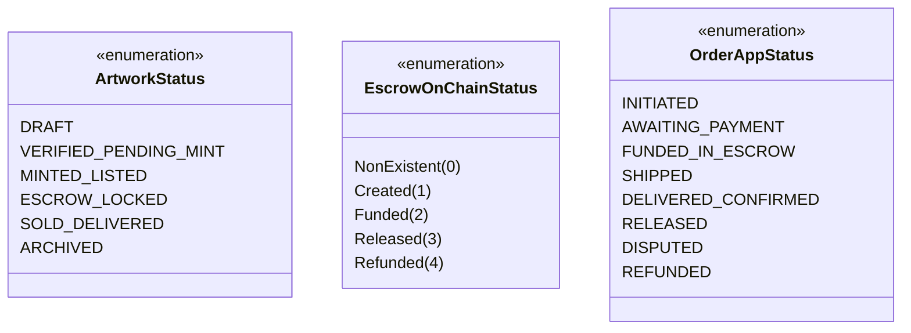

# SENDA — CONTRAT D'INTÉGRATION TECHNIQUE INTER-COMPOSANTS
**Protocole d'Interopérabilité Frontend (Nathan) • Blockchain (Victor) • Backend/IPFS (Benie)**  
**Projet :** SENDA — Marketplace décentralisée de l'artisanat congolais  
**Slogan :** « L'artisanat congolais, authentifié et valorisé. »  
**Version :** 1.0 — Contrat d'Interface Normatif  
**Date d'entrée en vigueur :** 25 Octobre 2026  

---

## 1. Objet et Périmètre du Contrat

Le présent document constitue la **spécification pivot engageante** entre les trois pôles de développement de SENDA :
- **Pôle 1 : Frontend & Intégration Web3** — Confié à **Kabongo Mukola Nathan**.
- **Pôle 2 : Smart Contracts & Blockchain** — Confié à **Losongo Kingombe Victor**.
- **Pôle 3 : Backend, IPFS & Assurance Qualité** — Confié à **Tuasansilu Lufuma Benie**.

Toute modification unilatérale d'un schéma de données, d'une signature de fonction Solidity, d'une route API ou d'un statut métier est formellement proscrite sans révision préalable de ce document.

---

## 2. Dictionnaire des Modèles de Données Communs

Pour éviter toute ambiguïté sur les types de données échangés, le tableau ci-dessous fixe les modèles partagés entre TypeScript (Frontend/Backend), PostgreSQL (Prisma) et Solidity.

### 2.1. Entité `User` & `ArtisanProfile`

| Champ | Type TypeScript | Type PostgreSQL | Type Solidity | Origine / Responsable | Description |
| :--- | :--- | :--- | :--- | :--- | :--- |
| `id` | `string` (UUID v4) | `UUID` (PK) | N/A | Backend (DB) | Identifiant unique interne |
| `walletAddress` | `string` (0x...) | `VARCHAR(42)` (UK) | `address` | Frontend (Wallet) | Adresse Ethereum normalisée EIP-55 |
| `displayName` | `string` | `VARCHAR(100)` | N/A | Utilisateur / Frontend | Nom public ou raison sociale |
| `role` | `"BUYER" \| "ARTISAN" \| "ADMIN"` | `VARCHAR(20)` | N/A | Backend (RBAC) | Rôle applicatif |
| `verificationStatus` | `"PENDING" \| "VERIFIED" \| "REJECTED"` | `VARCHAR(20)` | N/A | Backend (Audit) | Statut d'audit terrain de l'artisan |
| `locationProvince` | `string` | `VARCHAR(50)` | N/A | Artisan / Frontend | Province de RDC (ex: "Kwilu") |
| `bio` | `string?` | `TEXT` | N/A | Artisan / Frontend | Historique et tradition de l'atelier |

### 2.2. Entité `Artwork` & `NFTRecord`

| Champ | Type TypeScript | Type PostgreSQL | Type Solidity | Origine / Responsable | Description |
| :--- | :--- | :--- | :--- | :--- | :--- |
| `id` | `string` (UUID v4) | `UUID` (PK) | N/A | Backend (DB) | Identifiant interne stable de l'œuvre |
| `artisanId` | `string` (UUID v4) | `UUID` (FK) | N/A | Backend | Référence au créateur |
| `title` | `string` | `VARCHAR(150)` | N/A | Frontend / Artisan | Titre officiel de la création |
| `category` | `string` | `VARCHAR(50)` | N/A | Frontend / Artisan | Catégorie artisanale SENDA |
| `priceWei` | `string` (numeric) | `NUMERIC(78,0)` | `uint256` | Frontend / Contrat | Prix en jetons STT exprimé en Wei |
| `royaltyBps` | `number` (500..1000) | `INTEGER` | `uint96` | Artisan / Contrat | Redevance ERC-2981 (5% à 10%) |
| `ipfsImageUri` | `string` (ipfs://) | `VARCHAR(255)` | N/A | Backend / Pinata | URI de l'image haute résolution |
| `ipfsMetadataUri` | `string` (ipfs://) | `VARCHAR(255)` | `string` | Backend / Pinata | `tokenURI` canonique du NFT |
| `tokenId` | `number?` | `BIGINT` | `uint256` | Smart Contract | ID incrémental ERC-721 du jeton |
| `contractAddress` | `string?` | `VARCHAR(42)` | `address` | Blockchain / Victor | Adresse de déploiement de `SendaNFT` |
| `mintTxHash` | `string?` | `VARCHAR(66)` | `bytes32` | Blockchain (Tx) | Hash de transaction de frappe |
| `status` | `ArtworkStatus` | `VARCHAR(30)` | N/A | Backend / Système | État du cycle de vie de l'œuvre |

### 2.3. Entité `Order` & `EscrowRecord`

| Champ | Type TypeScript | Type PostgreSQL | Type Solidity | Origine / Responsable | Description |
| :--- | :--- | :--- | :--- | :--- | :--- |
| `id` | `string` (UUID v4) | `UUID` (PK) | N/A | Backend (DB) | Identifiant interne de commande |
| `orderIdHex` | `string` (0x... 32B) | `VARCHAR(66)` (UK) | `bytes32` | Backend / Frontend | `keccak256(abi.encodePacked(orderUuid))` |
| `artworkId` | `string` (UUID v4) | `UUID` (FK) | N/A | Frontend / Backend | Œuvre achetée |
| `buyerAddress` | `string` (0x...) | `VARCHAR(42)` | `address` | Frontend (Buyer) | Portefeuille de l'acheteur |
| `sellerAddress` | `string` (0x...) | `VARCHAR(42)` | `address` | Backend (Seller) | Portefeuille de l'artisan vendeur |
| `amountWei` | `string` (numeric) | `NUMERIC(78,0)` | `uint256` | Backend / Contrat | Montant sous séquestre en Wei |
| `depositTxHash` | `string?` | `VARCHAR(66)` | `bytes32` | Frontend / Escrow | Hash du dépôt `depositPayment` |
| `releaseTxHash` | `string?` | `VARCHAR(66)` | `bytes32` | Frontend / Escrow | Hash de la libération `confirmReceiptAndRelease` |
| `escrowStatus` | `EscrowStatus` | `VARCHAR(30)` | `enum OrderStatus` | Smart Contract | État on-chain dans `SendaEscrow.sol` |

---

## 3. Matrice Normative des États Métier

Pour prévenir les confusions entre l'état applicatif et l'état blockchain, les statuts sont strictement disjoints.

### 3.1. Typologie des États



### 3.2. Matrice de Transition du Séquestre Physique (`SendaEscrow`)

| État Initial | Action Déclenchante | Acteur Autorisé | Préconditions Techniques | État Final | Événement Blockchain |
| :--- | :--- | :--- | :--- | :--- | :--- |
| `NonExistent` (0) | `depositPayment(orderId, tokenId, seller, amount)` | Acheteur (`buyer`) | `orderId` unique, `amount > 0`, `allowance >= amount`, contrat non suspendu | `Funded` (2) | `PaymentDeposited` |
| `Funded` (2) | `confirmReceiptAndRelease(orderId)` | Acheteur (`buyer`) | `msg.sender == order.buyer`, solde suffisant dans le contrat | `Released` (3) | `PaymentReleased` |
| `Funded` (2) | `refundBuyer(orderId)` | Propriétaire / Arbitre (`owner`) | Litige formel avéré ou délai forclos sans expédition | `Refunded` (4) | `PaymentRefunded` |

---

## 4. Protocole de Synchronisation On-Chain / Off-Chain

### 4.1. Règle Fondamentale de la Source de Vérité
- **Pour les flux financiers et la propriété :** La blockchain Polygon Amoy est la **source de vérité absolue et irrévocable**.
- **Pour l'indexation, la recherche et le relationnel :** La base de données PostgreSQL est un **cache applicatif enrichi**.
- **Règle d'or :** L'API backend ne met jamais à jour un statut en `Funded` ou `Released` sur simple déclaration du client. Elle doit impérativement **vérifier le reçu cryptographique (`TransactionReceipt`)** auprès du nœud RPC Polygon Amoy.

### 4.2. Algorithme de Calcul de l'`orderId` On-Chain
Pour garantir la correspondance biunivoque entre l'UUID PostgreSQL et le `bytes32` Solidity :
```typescript
// Côté Frontend & Backend (TypeScript avec viem/ethers)
import { keccak256, toHex } from "viem";

export function generateOnChainOrderId(orderUuid: string): `0x${string}` {
  // Hash keccak256 de la chaîne UUID canonique en UTF-8
  return keccak256(toHex(orderUuid));
}
```
Dans `SendaEscrow.sol`, le contrat stocke directement la clé :
```solidity
mapping(bytes32 => Order) public orders;
```

### 4.3. Protocole de Validation des Reçus de Transaction (`/api/orders/:id/sync`)
1. Le frontend soumet le hash `txHash` au backend.
2. Le backend interroge le RPC Polygon Amoy via `viem` / `ethers.JsonRpcProvider`.
3. Le backend vérifie :
   - Que `receipt.status === 1` (succès de l'exécution EVM).
   - Que le contrat appelé est bien l'adresse officielle de `SendaEscrow`.
   - Que l'événement `PaymentDeposited` (ou `PaymentReleased`) a été émis avec le bon `orderId`.
4. Si les critères sont validés, PostgreSQL bascule la commande à son nouvel état.
5. **Prévention des doubles dépenses :** Si le `txHash` a déjà été consommé pour un autre `orderId`, la requête est rejetée avec un code `HTTP 409 Conflict`.

---

## 5. Normes et Conventions Techniques Communes

1. **Adresses Ethereum :**  
   Toutes les adresses doivent être représentées sous format checksum EIP-55 (ex: `0x70997970C51812dc3A010C7d01b50e0d17dc79C8`).
2. **Représentation Monétaire (STT) :**  
   Le jeton `SendaTestToken` comporte 18 décimales.
   - Les calculs arithmétiques internes s'effectuent exclusivement en `BigInt` (en Wei).
   - L'API REST sérialise systématiquement les montants sous forme de chaînes de caractères numériques (ex: `"180000000000000000000"`).
   - **Interdiction absolue** d'utiliser des nombres à virgule flottante (`number` JavaScript ou `FLOAT` SQL) pour les soldes financiers.
3. **Format des Réponses API :**  
   Toutes les réponses de l'API REST respectent l'enveloppe canonique :
   ```json
   {
     "success": true,
     "data": { ... },
     "meta": { "timestamp": "2026-10-25T16:00:00.000Z" }
   }
   ```
   En cas d'erreur :
   ```json
   {
     "success": false,
     "error": {
       "code": "INSUFFICIENT_ALLOWANCE",
       "message": "Le contrat de séquestre n'a pas l'autorisation requise sur vos jetons STT."
     }
   }
   ```
4. **URIs Décentralisées IPFS :**  
   Le format canonique enregistré en base et on-chain est `ipfs://<CID_V1>/chemin`. Les URLs de passerelle HTTP (`https://gateway.pinata.cloud/ipfs/...`) ne sont utilisées que dynamiquement pour le rendu visuel dans le navigateur.
