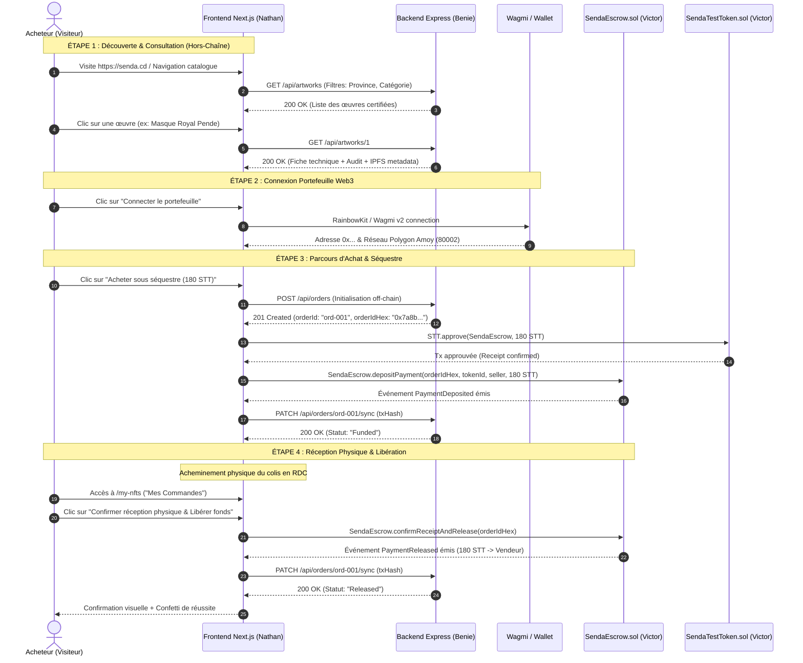
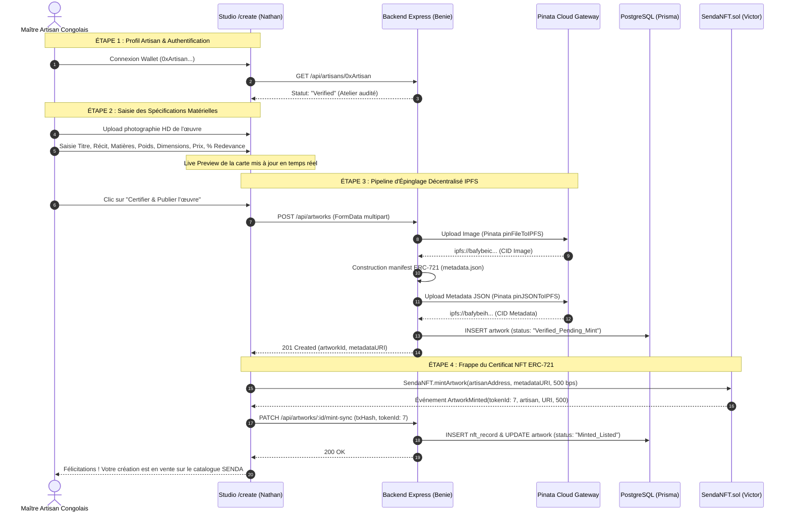

# SENDA — SCÉNARIOS UTILISATEURS DÉTAILLÉS & PARCOURS SYSTÈME
**Spécifications des Parcours Acheteur, Visiteur et Artisan — Interactions Frontend, Blockchain & Backend**  
**Projet :** SENDA — Marketplace décentralisée de l'artisanat congolais  
**Slogan :** « L'artisanat congolais, authentifié et valorisé. »  
**Cadre académique :** Master 1 Informatique — Groupe 02  
- **Kabongo Mukola Nathan** *(Frontend & Intégration Web3)*
- **Losongo Kingombe Victor** *(Smart Contracts & Architecture Blockchain)*
- **Tuasansilu Lufuma Benie** *(Backend, IPFS & Assurance Qualité)*  
**Date :** Octobre 2026 | **Version :** 1.0 — Référence Opérationnelle  

---

## 1. Principes Fondamentaux de Conception des Parcours

1. **Accessibilité Sans Friction Préalable (Web2-Friendly) :**  
   Tout utilisateur (acheteur local ou diaspora) peut explorer le catalogue, rechercher des œuvres, filtrer par province de RDC, consulter les dossiers d'authenticité et lire les fiches d'artisans **sans obligation de connecter un portefeuille Web3**. La connexion de MetaMask n'est requise qu'au moment d'engager une transaction de paiement ou de publier une œuvre.

2. **Dissociation Rigoureuse : Vérité Physique vs Certificat On-Chain :**  
   L'enregistrement d'un jeton NFT ERC-721 sur Polygon Amoy atteste de l'antériorité et de l'unicité du certificat numérique, **mais ne prouve pas par magie l'authenticité physique de l'objet**. Le système SENDA établit un protocole à trois niveaux de confiance :
   - *Données déclaratives de l'artisan* (bois, dimensions, histoire culturelle).
   - *Rapport d'audit physique SENDA* (contrôle matière et visite d'atelier en RDC).
   - *Registre immuable Blockchain & IPFS* (hachage de contenu et traçabilité on-chain).

3. **Protection Intégrale par Séquestre Physique (`SendaEscrow`) :**  
   Aucun fonds n'est transmis directement à l'artisan lors de la commande. Les jetons de test [`SendaTestToken`](file:///d:/SENDA/NFT-market-Place-main/packages/contracts/contracts/SendaTestToken.sol) (`STT`) restent consignés dans le contrat intelligent jusqu'à ce que l'acheteur atteste de la réception matérielle conforme de la création.

---

## 2. SCÉNARIO UTILISATEUR A — VISITEUR & ACHETEUR

### Étape 1 : Découverte et Navigation Libre
- **Action de l'utilisateur :** L'acheteur arrive sur la page d'accueil [`apps/web/app/page.tsx`](file:///d:/SENDA/NFT-market-Place-main/apps/web/app/page.tsx).
- **Interface & Système :**
  - Aucun bandeau intrusif ne bloque la navigation.
  - Le catalogue présente les créations artisanales classées par province de RDC (*Kwilu, Grand Kasaï, Haut-Katanga, Kongo Central, Sankuru, Haut-Lomami, Haut-Uele*).
  - L'acheteur peut saisir un texte de recherche (*« Pende »*, *« malachite »*, *« raphia »*) ou sélectionner une catégorie.
  - Chaque carte d'œuvre affiche : photo HD sans rognage sur socle muséal, province, macaron de vérification d'atelier, prix en `STT` et pourcentage de droit de suite créateur.

### Étape 2 : Consultation de la Fiche Détaillée (`/nft/[id]`)
- **Action de l'utilisateur :** L'acheteur clique sur l'œuvre pour consulter son dossier complet.
- **Interface & Système :**
  - **Fiche Technique :** Matériaux précis (*bois de wengé, pigments naturels, fibres de raphia*), dimensions exactes (*38 x 24 x 18 cm*), poids vérifié (*1.35 kg*), date de création et biographie du maître artisan.
  - **Audit & Traçabilité :** Statut de vérification physique (*« Certifié SENDA — Atelier audité sur site »*), identifiant de l'inspecteur terrain, date d'inspection et garanties d'emballage sécurisé.
  - **Dossier Blockchain & IPFS :** Lien vers le manifeste JSON immuable IPFS (`ipfs://bafybei.../metadata.json`), adresse du contrat ERC-721 sur Polygonscan, ID du jeton (#1).

### Étape 3 : Connexion du Portefeuille Web3
- **Action de l'utilisateur :** L'acheteur clique sur le bouton *« Connecter le portefeuille »* (ou déclenche un achat).
- **Contrôles Système (Wagmi v2 / RainbowKit) :**
  1. *Détection du Wallet :* Support de MetaMask, Coinbase Wallet, WalletConnect et navigateurs Web3 mobiles.
  2. *Contrôle du Réseau :* Vérification stricte du Chain ID (`80002` pour Polygon Amoy). Si le portefeuille est sur Ethereum Mainnet ou Sepolia, Wagmi invite automatiquement au basculement (*Switch Network*).
  3. *Gestion des Événements :* L'application écoute `accountsChanged` et `chainChanged` pour rafraîchir l'interface sans crash.

### Étape 4 : Achat sous Séquestre Conditionnel
- **Action de l'utilisateur :** L'acheteur clique sur *« Acheter (Séquestre) »*.
- **Workflow Technique d'Exécution :**
  1. **Réservation Off-Chain :** Le frontend appelle `POST /api/orders` pour initialiser la commande dans PostgreSQL avec statut `Created` et générer le hachage d'identifiant `bytes32 orderId = keccak256(orderUuid)`.
  2. **Contrôle de Solde STT :** Le frontend lit le solde de l'acheteur via `SendaTestToken.balanceOf(buyer)`. Si `solde < prix`, la modale propose immédiatement d'alimenter le compte via le *Robinet STT (Faucet)* (+100 STT).
  3. **Approbation ERC-20 (Phase 1) :** Si `allowance(buyer, SendaEscrow) < prix`, une transaction `STT.approve(SendaEscrow, montant)` est sollicitée auprès du portefeuille. L'UI attend le reçu de confirmation blockchain.
  4. **Dépôt sous Séquestre (Phase 2) :** L'UI soumet `SendaEscrow.depositPayment(orderId, artworkTokenId, seller, montant)`. Le contrat intelligent prélève les jetons via `transferFrom` et verrouille les fonds. L'état on-chain passe à `Funded`.
  5. **Notification d'Événement :** Le contrat émet `PaymentDeposited(orderId, buyer, seller, amount, tokenId)`. Le frontend transmet le reçu de transaction à `PATCH /api/orders/:id/sync` pour mettre à jour la base PostgreSQL.

### Étape 5 : Suivi de Commande & Expédition
- **Action de l'utilisateur :** L'acheteur consulte son tableau de bord sur [`/my-nfts`](file:///d:/SENDA/NFT-market-Place-main/apps/web/app/my-nfts/page.tsx).
- **Interface & Système :**
  - La commande apparaît avec le macaron orange `Funded (Fonds Verrouillés)`.
  - Affichage des informations clés : N° de commande, identifiant de séquestre hexadécimal, artisan expéditeur, province d'origine et hash de la transaction de dépôt consultable sur Polygonscan.
  - L'artisan est notifié hors-chaîne pour emballer la création avec le scellé de garantie physique et procéder à l'expédition.

### Étape 6 : Réception Matérielle et Libération des Fonds
- **Action de l'utilisateur :** À la réception du colis physique en RDC ou à l'international, l'acheteur inspecte l'œuvre et clique sur *« Confirmer réception physique & Libérer fonds »*.
- **Workflow Technique d'Exécution :**
  1. **Contrôle d'Éligibilité :** L'UI et le contrat vérifient que l'appelant `msg.sender` est strictement égal à `order.buyer` et que l'état du séquestre est bien `Funded`.
  2. **Signature de Libération :** L'acheteur signe la transaction appelant `SendaEscrow.confirmReceiptAndRelease(orderId)`.
  3. **Transfert Irrévocable :** Le contrat de séquestre transfère les jetons `STT` consignés vers le portefeuille de l'artisan créateur (`order.seller`). L'état passe définitivement à `Released`.
  4. **Émission d'Événement & Indexation :** Le contrat émet `PaymentReleased(orderId, seller, amount)`. L'API met à jour la commande dans PostgreSQL (`status: "Released"`).
  5. **Retour Visuel :** L'UI affiche la pastille verte de succès, déclenche une animation de confirmation et archive la commande.

---

## 3. SCÉNARIO UTILISATEUR B — ARTISAN CRÉATEUR

### Étape 1 : Profil & Vérification Préalable
- **Connexion du Portefeuille :** L'artisan connecte son adresse de portefeuille Web3.
- **Contrôle d'Accès Côté Serveur :** L'API vérifie le rôle associé au compte dans la table `users`. Pour publier des créations certifiées, l'artisan doit disposer du statut `VERIFIED_ARTISAN`.
- **Audit Préalable :** Si le compte est nouveau, l'artisan soumet une demande de certification d'atelier avec localisation géographique (ex: *Gungu, Kwilu* ou *Mweka, Kasaï*). Les inspecteurs SENDA valident l'authenticité de l'atelier sur site avant d'accorder le droit de frappe de certificats d'appellation contrôlée.

### Étape 2 : Numérisation & Saisie de la Fiche Technique
- **Action de l'artisan sur [`/create`](file:///d:/SENDA/NFT-market-Place-main/apps/web/app/create/page.tsx) :**
  - **Fichier visuel :** Téléversement d'une photographie haute résolution (minimum 1024x1024 px, formats JPG/PNG/WebP, max 10 Mo).
  - **Informations culturelles :** Titre de l'œuvre (*ex: Statuette Luba Shankadi*), tradition ethnique, démarche spirituelle ou rituelle.
  - **Origine géographique :** Sélection de la province de RDC (*ex: Haut-Lomami*).
  - **Spécifications matérielles :** Détail des essences de bois (*iroko, wengé, ébène*), pigments naturels, métaux (*cuivre rouge martelé, laiton*), dimensions précises et poids.
  - **Paramètres économiques :** Prix sous séquestre en jetons `STT` et curseur de **droit de suite (redevance ERC-2981)** entre 5 % et 10 %.

### Étape 3 : Traitement Serveur & Épinglage Décentralisé IPFS
- **Sécurité des Clés API :** Le frontend ne communique jamais directement avec Pinata. Les requêtes transitent par le backend Node.js (`POST /api/artworks`), préservant la confidentialité des identifiants `PINATA_JWT`.
- **Validation Côté Serveur :**
  - Contrôle du type MIME et de la signature binaire du fichier.
  - Nettoyage et assainissement des chaînes de caractères (prévention des injections XSS).
- **Épinglage P2P :**
  1. Épinglage de la photographie : Obtention du CID immuable `ipfs://<image_cid>/nom_fichier.jpg`.
  2. Construction du manifeste JSON standardisé OpenSea / ERC-721 avec attributs enrichis (*Province, Ethnie, Matière, Poids, Audit SENDA*).
  3. Épinglage du manifeste JSON : Obtention du `tokenURI` canonique `ipfs://<metadata_cid>/metadata.json`.
- **Persistance Intermédiaire :** Enregistrement de l'œuvre dans PostgreSQL avec le statut `Pending_Mint`.

### Étape 4 : Frappe du Certificat NFT (`SendaNFT.sol`)
- **Action de l'artisan :** Signature de la transaction de minting sur son portefeuille Web3.
- **Exécution On-Chain :**
  - Appel de `SendaNFT.mintArtwork(artisanAddress, metadataURI, royaltyBps)`.
  - Le contrat attribue un nouvel identifiant incrémental `tokenId`.
  - Le contrat configure la redevance via le standard ERC-2981 (`_setTokenRoyalty(tokenId, artisanAddress, royaltyBps)`).
  - Émission de l'événement `ArtworkMinted(tokenId, artisan, metadataURI, royaltyBps)`.
- **Indexation :** Le frontend soumet le hash de transaction au backend, qui crée l'enregistrement dans la table `nft_records` et bascule l'œuvre au statut `Minted_Listed`.

### Étape 5 : Gestion des Ventes & Droits de Suite
- **Suivi des Commandes :** L'artisan consulte l'onglet *« Mes Pièces Enregistrées »* dans son espace personnel.
- **Notification de Dépôt :** Dès qu'un acheteur consigne les fonds dans `SendaEscrow`, la commande passe en `Funded`. L'artisan prépare le conditionnement sécurisé.
- **Règlement :** Dès la réception validée par l'acheteur, le smart contract verse les jetons `STT` directement sur l'adresse de l'artisan.
- **Pérennité des Droits de Suite :** Si l'œuvre est revendue ultérieurement par son propriétaire sur une place de marché conforme ERC-2981, l'artisan perçoit automatiquement sa redevance de 5 % à 10 % sur le prix de revente.
